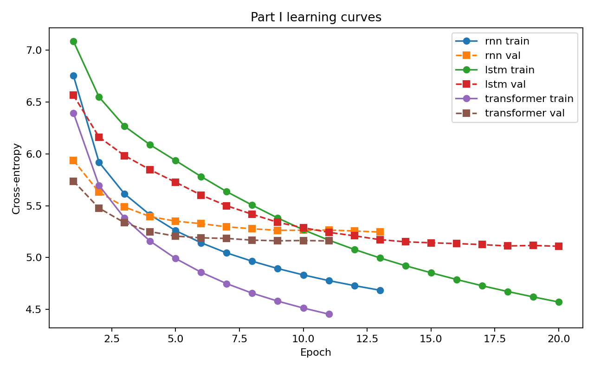
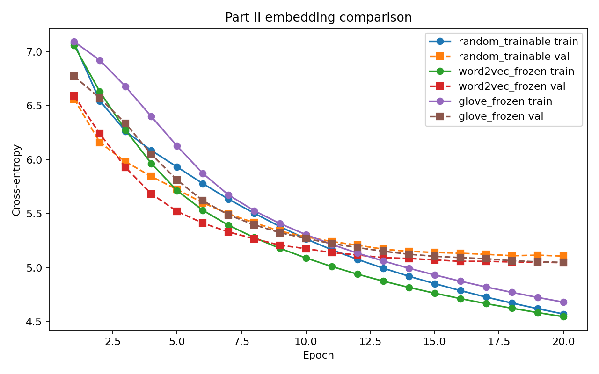

# Language Models, Embeddings, and Transfer to Sentiment Classification

This repository contains the NUS DSA4213 Assignment 1 course project. It studies how language-model
architecture and embedding initialization affect next-token prediction, and whether those
differences transfer to downstream sentiment classification.

## Key Results

The tables report the mean and sample standard deviation across seeds 42, 1, 2, and 3. All values
come from [`analysis/multiseed_summary.json`](analysis/multiseed_summary.json).

### Part I: language-model test perplexity

| Model | Test perplexity (mean ± SD) |
|---|---:|
| Trigram | 264.65 ± 0.00 |
| RNN | 177.04 ± 1.38 |
| LSTM | **154.14 ± 1.36** |
| Transformer | 162.46 ± 0.46 |

The trigram result is deterministic; its zero standard deviation does not represent repeated
stochastic training.

### Part II: LSTM embedding test perplexity

| Embedding setting | Test perplexity (mean ± SD) |
|---|---:|
| Random, trainable | 154.14 ± 1.36 |
| Word2Vec, frozen | 146.60 ± 0.57 |
| GloVe, frozen | **146.05 ± 2.57** |

### Part III: frozen representation transfer to SST-2

| Representation | Accuracy (mean ± SD) | Macro-F1 (mean ± SD) |
|---|---:|---:|
| LSTM masked mean | 0.6345 ± 0.0111 | 0.6336 ± 0.0105 |
| Transformer masked mean | **0.6416 ± 0.0174** | **0.6405 ± 0.0173** |
| LSTM last state | 0.6095 ± 0.0129 | 0.6066 ± 0.0123 |

Main findings:

- Part I has the same ranking for all four seeds: LSTM, Transformer, RNN, then trigram by increasing
  perplexity. The mean LSTM–Transformer gap is larger than the observed combined sample standard
  deviation.
- Frozen Word2Vec and GloVe embeddings both improve mean perplexity over the trainable random
  embedding. Their ordering changes across seeds, and their mean gap is smaller than the observed
  variation.
- Transformer mean pooling has the highest average SST-2 accuracy, but LSTM mean pooling is higher
  for seed 2; the average difference between the two is smaller than their observed variation.
- Both masked-mean representations outperform the LSTM last-state control on average. Language-model
  perplexity ranking therefore does not transfer directly to classification ranking.

## Learning Curves

Twenty-epoch Part I curves:



Twenty-epoch Part II embedding comparison:



## Project Structure

```text
.
├── config.yaml                 # Hyperparameters and output paths
├── data.py                     # WikiText/SST-2 loading, preprocessing, vocabulary, and datasets
├── models.py                   # RNN, LSTM, and causal Transformer implementations
├── ngram.py                    # Interpolated trigram language model
├── train.py                    # Shared training, evaluation, timing, generation, and plotting
├── part1.py                    # Architecture comparison
├── part2.py                    # LSTM embedding comparison
├── part3.py                    # Frozen-representation SST-2 evaluation
├── run_all.py                  # Sequential runner for all three parts
├── run_seeds.sh                # Colab script for seeds 1, 2, and 3 after seed 42
├── aggregate_seeds.py          # Four-seed aggregation and consistency checks
├── colab_run.ipynb             # Complete clean Colab workflow
├── requirements.txt            # Local Python dependencies
├── analysis/                   # Result overview and generated multi-seed summaries
├── report/                     # LaTeX report source, bibliography, and report figures
├── results_e8/                 # Seed-42 supplementary run with 8 training epochs
├── results_e20/                # Seed-42 main run with 20 training epochs
├── results_seed1/              # Seed-1 main run with 20 training epochs
├── results_seed2/              # Seed-2 main run with 20 training epochs
└── results_seed3/              # Seed-3 main run with 20 training epochs
```

The code writes full outputs to `results/` and checkpoints to `checkpoints/` by default. Completed
result directories were renamed for the submitted layout so that training budget and seed remain
unambiguous. Checkpoints are excluded from the repository.

Each result directory contains:

- `part1/`: summaries, logs, vocabulary, generations, tables, and architecture loss curves.
- `part2/`: summaries, logs, embedding coverage, generations, tables, and embedding loss curves.
- `part3/`: summaries, logs, tables, and per-example SST-2 predictions in `errors.csv`.

## Setup

### Local environment

Python 3.13 was used for the reported run. Create the virtual environment outside this repository,
then install the dependencies:

```bash
python -m venv /path/outside/this/repository/dsa4213-env
source /path/outside/this/repository/dsa4213-env/bin/activate
python -m pip install -r requirements.txt
```

On Windows PowerShell, activate the environment with:

```powershell
& C:\path\outside\this\repository\dsa4213-env\Scripts\Activate.ps1
python -m pip install -r requirements.txt
```

The reported experiments used a Tesla T4, Python 3.13.15, and PyTorch 2.11.0, as recorded in
[`results_e20/part1/summary.json`](results_e20/part1/summary.json).

### Google Colab

Select a T4 GPU runtime. Keep Colab's preinstalled PyTorch, NumPy, scikit-learn, and Matplotlib,
and install only the missing packages:

```bash
pip install -q --only-binary=:all: gensim datasets
```

See [`colab_run.ipynb`](colab_run.ipynb) for the complete Drive-based workflow.

## Reproduction

All commands below are run from the project root.

### Quick pipeline check

```bash
python run_all.py --quick
```

Quick artifacts are isolated under `results/*/quick/` and `checkpoints/*/quick/`; they are smoke
tests, not experimental results.

### Main 20-epoch seed-42 run

The committed `config.yaml` has `seed: 42`, `train.epochs: 20`, and `word2vec.epochs: 5`.

```bash
python run_all.py
```

After completion, preserve the outputs as `results_e20/` and the checkpoints under a corresponding
renamed checkpoint directory before starting another run.

### Supplementary 8-epoch run

Change only `train.epochs` to 8 in `config.yaml`, keep `seed: 42` and `word2vec.epochs: 5`, and run:

```bash
python run_all.py
```

Rename the completed `results/` and `checkpoints/` directories to `results_e8/` and
`checkpoints_e8/`, then restore `train.epochs` to 20.

### Additional 20-epoch seeds

On Colab, after the seed-42 main run still exists as `results/` and `checkpoints/`, run:

```bash
bash run_seeds.sh
```

The script stages seed 42, runs seeds 1, 2, and 3 sequentially, and restores seed 42 in
`config.yaml`. Rename `results_seed42/` to `results_e20/` after it finishes.

### Aggregate the four seeds

```bash
python aggregate_seeds.py
```

This regenerates `analysis/multiseed_summary.md` and
`analysis/multiseed_summary.json` using sample standard deviation and verifies that the four
SST-2 test-label sequences agree.

Recorded model-training components on the T4 total 29.38 minutes for the seed-42 8-epoch run and
71.74, 71.87, 71.89, and 71.95 minutes for the 20-epoch runs with seeds 42, 1, 2, and 3,
respectively. These totals are calculated from the timing fields in the corresponding Part I and
Part II `summary.json` files and exclude downloads and Part III overhead.

## Data

Data is downloaded automatically at runtime and is not stored in this repository.

- **WikiText-2:** HuggingFace
  [`Salesforce/wikitext`, `wikitext-2-v1`](https://huggingface.co/datasets/Salesforce/wikitext),
  used for language modelling and in-domain Word2Vec training.
- **SST-2:** HuggingFace
  [`nyu-mll/glue`, `sst2`](https://huggingface.co/datasets/nyu-mll/glue), used for frozen
  representation evaluation.
- **GloVe:** gensim-data
  [`glove-wiki-gigaword-100`](https://github.com/RaRe-Technologies/gensim-data), downloaded by
  gensim during Part II.

HuggingFace Datasets and gensim use their standard user-level caches.

## Limitations

- The LSTM is still improving at the end of the main training budget, so its final ranking may
  change with longer training.
- Model sizes differ, so architecture comparisons are confounded by parameter count.
- WikiText-2 and SST-2 have different domains, and SST-2 still contains out-of-vocabulary tokens.
- GPU kernels can be nondeterministic, and four seeds provide only a limited estimate of variation.
- Logistic-regression selections reach both boundaries of the tested `C` grid across seeds, so the
  search range may be too narrow.
- The 8-epoch comparison contains only seed 42.

## References

- Merity et al. (2017), [*Pointer Sentinel Mixture Models*](https://arxiv.org/abs/1609.07843)
  (WikiText).
- Wang et al. (2018), [*GLUE: A Multi-Task Benchmark and Analysis
  Platform*](https://arxiv.org/abs/1804.07461).
- Socher et al. (2013), [*Recursive Deep Models for Semantic Compositionality Over a Sentiment
  Treebank*](https://aclanthology.org/D13-1170/) (SST).
- Pennington, Socher, and Manning (2014), [*GloVe: Global Vectors for Word
  Representation*](https://aclanthology.org/D14-1162/).
- Řehůřek and Sojka (2010), [*Software Framework for Topic Modelling with Large
  Corpora*](https://radimrehurek.com/gensim/about.html) (gensim).
- Lhoest et al. (2021), [*Datasets: A Community Library for Natural Language
  Processing*](https://aclanthology.org/2021.emnlp-demo.21/) (HuggingFace Datasets).

## AI Use Statement

The code was written mainly by an AI programming assistant. The experimental design was proposed
with AI assistance and reviewed and approved by the author. The author ran the experiments,
checked the fairness of comparisons, and verified the results. The report was drafted with AI
assistance from the saved results and then reviewed and revised by the author.

**Academic Integrity:** This is course-assignment work shared for reference only. Do not copy it
for submission in any course.
